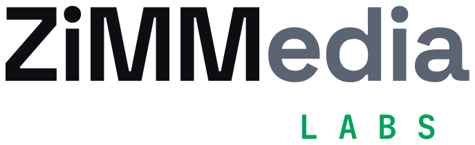

# What's up, I'm Zimm 👋

  <picture>
    <source media="(prefers-color-scheme: dark)" srcset="assets/zimmedia-labs-dark.png">
    
  </picture>

Solo dev @ ZiMMediaLabs. Godot, C#, and web. I build small, practical tools for games, hobbies, and whatever I’m into.

---

## 🌐 Live Web Apps (PWA)

Browser versions of my desktop apps, live on GitHub Pages. No download needed — open them in any browser, or install them to your desktop or phone home screen.

| App | Status | What it does | Launch |
| :--- | :---: | :--- | :---: |
| **🔥 Diablo Class Randomizer** |  | Picks your next class across Diablo I, II, III, IV, and Immortal. | [**Launch&nbsp;🚀**](https://zimmedialabs.github.io/Diablo-Class-Randomizer/) |
| **⚔️ WoW Forever Randomizer** |  | Faction → race → class. Let fate decide your next alt. | [**Launch&nbsp;🚀**](https://zimmedialabs.github.io/WoW-Forever-Randomizer/) |
| **🧭 Location Converter** |  | Formats Hackmud locations for your cracker scripts, right in the browser. | [**Launch&nbsp;🚀**](https://zimmedialabs.github.io/Location-Converter/) |
| **🧛 MonsterMatch** |  | Spooky memory card game with 12 hand-drawn pixel monsters, four difficulties, and bonus items. Install it like an app; works offline after your first play. | [**Play&nbsp;🎮**](https://zimmedialabs.github.io/MonsterMatch/) |

<b>📲 How to install these apps on desktop &amp; phone (click to expand)</b>

 

Open any app above with its **Launch / Play** button, then follow the steps for your device. Once
installed, it gets its own icon and opens in its own window, like a normal app. No app store is needed,
and it updates automatically.

| Device | Browser | Steps |
| :--- | :--- | :--- |
| 🖥️ Windows / Mac / Linux | **Chrome** | **⋮** menu → **Cast, save, and share** → **Install page as app** |
| 🖥️ Windows / Mac / Linux | **Edge** | Click the **App available** icon in the address bar → **Install** |
| 🍎 Mac (Sonoma or later) | **Safari** | **File** → **Add to Dock** |
| 🤖 Android | **Chrome** | **⋮** menu → **Add to home screen** → **Install** |
| 📱 iPhone / iPad | **Safari** | **Share** button → **Add to Home Screen** |

- **Firefox:** app installs are only supported on Windows, by pinning the site to the taskbar. On other
  systems, use one of the browsers above.
- **To uninstall:** remove it like any other app (right-click the icon, or long-press on a phone).

---

## 🛠️ Featured Repositories

| Repository | What it is | Stack |
| :--- | :--- | :---: |
| [**Diablo-Class-Randomizer**](https://github.com/ZiMMediaLabs/Diablo-Class-Randomizer) | WinForms app that picks your next class across every Diablo game |  |
| [**WoW-Forever-Randomizer**](https://github.com/ZiMMediaLabs/WoW-Forever-Randomizer) | Alliance / Horde / Either → race → class picker for busy players |  |
| [**Location-Converter**](https://github.com/ZiMMediaLabs/Location-Converter) | Windows utility that formats Hackmud locations for your cracker scripts |  |
| [**RRC--Enhanced-Power-Storage**](https://github.com/ZiMMediaLabs/RRC--Enhanced-Power-Storage) | Space Engineers mod for Rock Runner CORP — on Steam Workshop (PC) and mod.io (console) |  |
| [**ZombieSmashers**](https://github.com/ZiMMediaLabs/ZombieSmashers) | The brawler from *Building XNA 2.0 Games*, revived from dead XNA to MonoGame 3.8.6 / .NET 10 with LAN co-op, working shaders, keyboard + mouse, and resizable windows |  |
| [**dodge-the-creeps**](https://github.com/ZiMMediaLabs/dodge-the-creeps) | My first Godot 4 build — the official tutorial, start to finish |  |

---

## 🎮 In Development

**📼 REWIND OR DIE** — *Godot 4*
A VHS horror creature collector. Top-down RPG with grid-based combat: collect monster tapes, break the trance, and take down a media megacorp. Targeting PC and Trimui Brick.

**🧛 MonsterMatch** — *GameMaker Studio 2*
A pixel-art memory card game with 12 classic monsters. Four difficulties from Easy to Nightmare, bonus items like extra time and a second life, a lofi track for each difficulty, and saved best times. [Playable now in the browser](https://zimmedialabs.github.io/MonsterMatch/) — next up: a free itch.io release.

---

## 💻 Tech Stack & Tools

---

## 📬 Find Me

